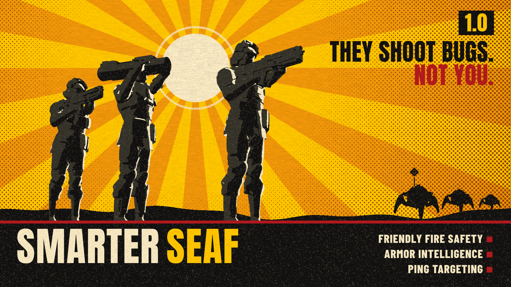

# Smarter SEAF
*They shoot bugs. Not you.*

Smarter SEAF gives the SEAF soldiers a new brain. They stop shooting through you, stop wasting their one EAT on small bugs, and go for the enemies you ping.

## Features

- **Friendly Fire Safety:** a SEAF soldier holds fire while you, a teammate, one of your sentries, another SEAF soldier or a civilian is in his line of fire, and picks another enemy instead. He also holds fire while his gun is pointed at a friend when he's staggered or getting up, so he doesn't spray bullets across his squad. The option chooses who is protected: *Helldivers and other troopers*, *Only helldivers* or *Only other troopers*.
- **Armor Intelligence:**
  - Soldiers know what their guns can hurt. Armor they can't get through is left for later while there's something else to shoot. With nothing else around, they shoot it anyway (ammo is no concern for their guns).
  - Specialists keep their one EAT for Chargers and heavier, and for structures it can destroy (fabricators, bug holes, Shrieker Nests, Spore Spewers, Gazers, Lightning Spires, Warp Gateways). A specialist who draws his EAT with nothing heavy around puts it away again after a few seconds.
  - Nobody wastes ammo on a Detector Tower they can't damage.
- **Ping Targeting:** soldiers within 50 m of you go for the enemy you ping, for up to 20 seconds, if they can see it and hurt it. Soldiers farther away keep fighting their own fight.
- **No shooting the dead or the unseen:** a soldier moves on the moment his target dies or goes out of sight, instead of firing at the spot.
- **Light on your PC:** the brain runs a fraction of a millisecond per frame.

## Options (Arsenal / HD2 Mod Manager)

- **Smarter SEAF**: the core. Keep this on.
- **Friendly Fire Safety**: choose who SEAF soldiers never shoot through: *Helldivers and other troopers* (you, your teammates and your sentries, other SEAF soldiers and civilians), *Only helldivers* or *Only other troopers*. Turn off at your own risk: they will fire through anyone, as in the base game.
- **Armor Intelligence**: armor they can't hurt is left for later, and specialists keep their EAT for heavy armor and structures. Turn off to leave targets to the game.
- **Ping Targeting**: soldiers within 50 m of you go for the enemy you ping. Turn off to leave your pings alone.

Each part keeps working when another is turned off.

## Requirements
[Bingus Shared Loader](https://www.nexusmods.com/helldivers2/mods/16292) v19 or newer, last in the load order.

## Download
Get the latest zip from the [Releases](../../releases/latest) page (the `Smarter-SEAF-<version>.zip` file, not the source code).

## Install / update

1. Install Bingus Shared Loader v19 or newer.
2. Add Smarter-SEAF-1.0.1.zip in Arsenal or the HD2 Mod Manager and check the options you want.
3. Purge, then Deploy (always both, every time you install or update), then restart the game.

## Uninstall
Remove it in your mod manager, then Purge and Deploy. Nothing is left behind in the game.

## Compatibility

- Only the SEAF soldiers run by your game are changed: when you host or play solo. When you join someone else's game, their game runs the soldiers.
- Works alongside Smarter Guard Dogs & Sentries (they're separate mods and can both be installed).
- Don't combine it with other mods that change SEAF soldier targeting.
- Made and tested on the September 2026 game version (the late-September patch).

## Known limitations

- **Host only:** the mod changes only the SEAF soldiers your own game runs, so it works when you host or play solo. When you join someone else's game, their game runs the soldiers and the mod leaves them alone.
- The game still decides when to shoot and where to walk. The mod only steers who a soldier may target, so a soldier blocked by a friend waits for a clear line rather than stepping aside.
- Line of sight updates about twice a second, so a soldier may briefly fire at cover or hesitate as enemies duck in and out of view.
- Pings count only for enemies the soldier can see; a soldier who can't get onto a pinged enemy within a couple of seconds goes back to his own fight.
- Grenades and mines aren't steered.
- After a game update the mod finds what it needs in the game's code again and remembers it for that game version. A part only switches itself off (changing nothing) when an update changes something it relies on, and the log says which.

## How it works
**It doesn't alter any game data.** No game files, weapon stats, damage or enemy values are changed. It's a Lua addon built on the Smarter Guard Dogs & Sentries engine: the game's own soldier AI stays in charge, and the mod only hides the enemies a soldier shouldn't shoot from his list and asks him to pick again. No DLLs are added, no game code is patched, and everything is put back when it's not needed.

## Troubleshooting
Attach SmarterSEAF.log to your bug report. You'll find it in %LOCALAPPDATA%\CowboyBingus\Helldivers2\Logs, next to the other Bingus mods' logs (paste that into the File Explorer address bar and press Enter). It lists what the mod did and any errors.

## Support

All my mods are free and always will be. Every release is rigorously tested, highly optimized and kept working through game updates. If you'd like to help me keep that up and build new mods, you can support me on [Patreon](https://www.patreon.com/c/Chefboiardee).

Thank you for diving with me!

## Credits

- **CowboyBingus**: Bingus Shared Loader.
- Armor values: Helldivers Wiki.

## Building from source
`src/build_seaf.py` (Python 3 and LuaJIT, used only to check the script loads) applies the SEAF changes to the Smarter Guard Dogs & Sentries engine (`src/sgd_core.lua`), adds `src/trooper_gun.lua`, packs it and the option add-ons into Helldivers 2 patch archives, and writes the Arsenal / HD2 Mod Manager zip:

```
cd src
LUAJIT=/path/to/luajit python3 build_seaf.py sgd_core.lua build
```

The zip it makes is the same one attached to each release (it also makes a Tester zip with extra logging for bug hunting).

## Changelog
See [CHANGELOG.md](CHANGELOG.md).

## License
Copyright (c) 2026 Th3chef. All rights reserved. You're welcome to read the source, report bugs and suggest fixes, but please ask before reusing it or reuploading the mod. See [LICENSE](LICENSE).
